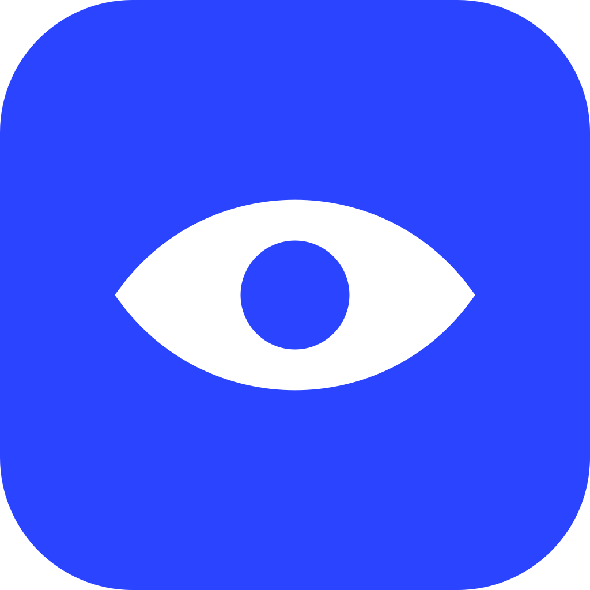

<p align="center">
  <picture>
    <source media="(prefers-color-scheme: dark)" srcset="assets/logo-dark.svg" />
    
  </picture>
</p>

<p align="center">
  <b>Open is the only verb.</b><br />
  A minimalist, read-only Markdown viewer. Opinionated, GitHub by default.
</p>

---

Oculis 是一个极简的只读 Markdown 浏览器. 不编辑, 不格式化, 不保存, 它唯一做的事情是打开. 文档按 GitHub 的样式渲染, 基于 Electron.

## 功能

- GitHub Flavored Markdown: 表格, 任务列表, 删除线, 自动链接, 脚注
- GitHub 风格的 [!NOTE] 等提示块, 标题锚点
- 代码高亮 (highlight.js GitHub 主题)
- Mermaid 图表, 由 [Pele](https://pele.run/) 渲染为 SVG, 自适应宽度, 可缩放
- 跟随系统亮色 / 暗色主题
- 文件变更自动刷新, 保持滚动位置
- 拖放打开, 命令行参数打开, 文件关联
- 相对路径图片, 点击 `.md` 链接在本窗口跳转, 外部链接交给系统浏览器

> [!NOTE]
> 只读, 不提供任何编辑功能.

## 使用

```sh
bun install
bun run start            # 空窗口, 拖入文件或 Ctrl+O
bun run start README.md  # 直接打开
bun run dist             # 打包安装程序
```

| 快捷键 | 作用 |
| --- | --- |
| `Ctrl+O` | 打开文件 |
| `Ctrl+R` | 重新加载 |
| `Ctrl+=` / `Ctrl+-` / `Ctrl+0` | 缩放 |
| `F11` | 全屏 |

菜单栏默认隐藏, 按 `Alt` 显示.

- [x] 只读渲染
- [ ] 编辑 (永远不会有)

## 设计



标志是一只睁开的眼睛: 打开文件, 就是睁开眼睛. 两片眼睑是同半径圆弧, 圆心与眼角构成 3 : 4 : 5 直角三角形, 瞳孔是唯一的品牌色 Iris `#2B44FF`, 文档内部则完全保持 GitHub 的配色. 空窗口时眼睛闭着, 拖入文件时睁开.

- 视觉识别规范: [`design/identity.html`](design/identity.html)
- 几何的唯一来源: [`scripts/brand.js`](scripts/brand.js), 修改后运行 `bun run icons` 重新生成 `assets/` 与 `build/` 下的标志和应用图标
